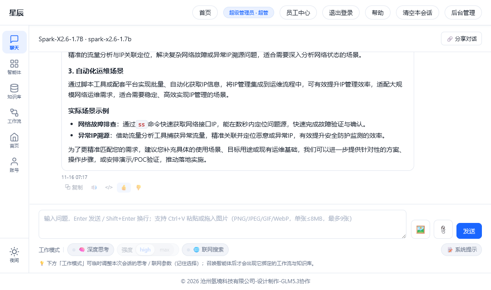
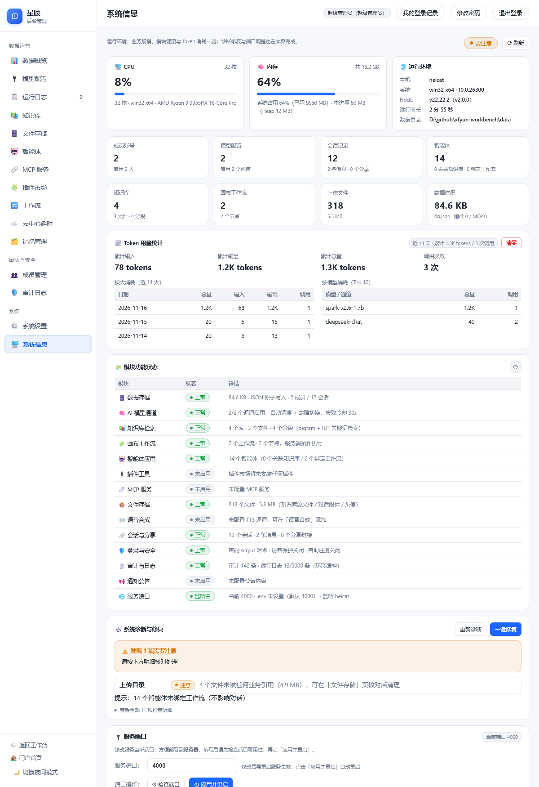
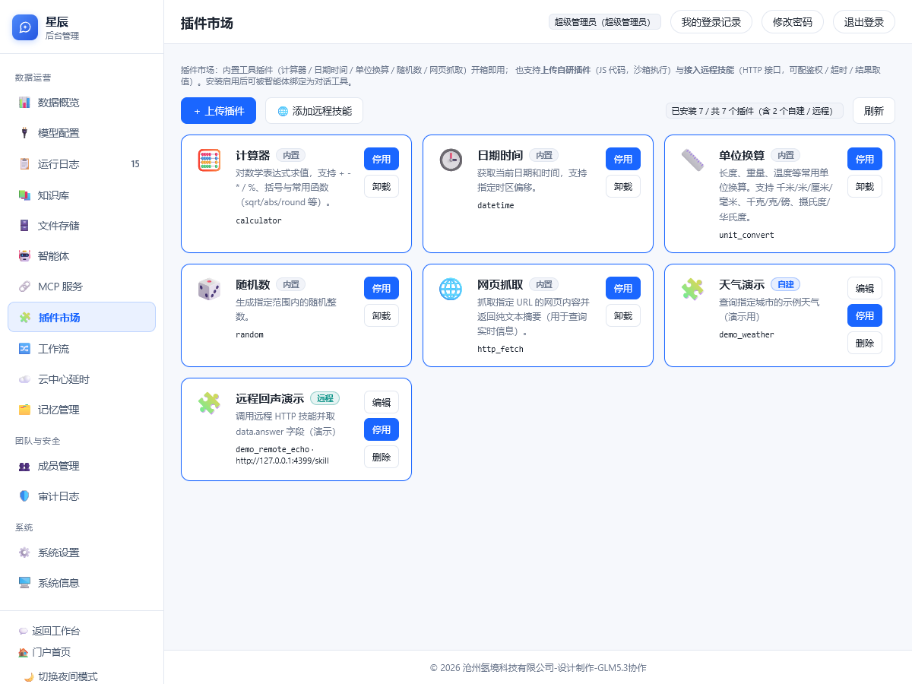

<div align="center">

# 星火工作台 · xfyun-workbench

**可私有化部署的企业级 AI 对话平台**
多模型接入 · 私有知识库 · 画布工作流 · 智能体 · MCP 与插件 · 团队权限与审计

[](https://nodejs.org)
[](LICENSE)
[](test)
[](package.json)
[](#设计取舍)

</div>

> 星星之火，可以燎原。 —— 沧州氢境科技有限公司

---

## 为什么要做这个

企业想要「自己的 ChatGPT」，真正的门槛往往不在模型，而在另外五件事：

- **数据不能出门** —— 资料、对话、日志必须留在内网；
- **知识要能检索** —— 让模型用自己的文档回答，而不是靠记忆编；
- **流程要能编排** —— 检索、判断、改写、回复要能拼成固定链路；
- **人要有权限** —— 谁能看哪个知识库、谁能改哪个智能体；
- **事故要能追溯** —— 登录、改配置、删数据都要留痕。

星火工作台把这些做成一个**单体应用**：`git clone → npm install → npm start`，五分钟在内网跑起来，数据 100% 在自己的机器上。

---

## 界面截图

| 对话工作台 | 后台 · 系统信息 |
| --- | --- |
|  |  |

| 插件市场（内置 / 自建 / 远程技能） |
| --- |
|  |

---

## ✨ 功能特性

### 对话
- 多会话管理、SSE 流式输出、思考过程折叠展示、会话批量多选删除
- **工作模式条**：深度思考（high / max）、联网搜索、系统提示按次开关，选择本地记忆
- 图片视觉理解（粘贴 / 拖拽 / 选择，≤8MB × 9 张）；文档 / 音视频 / 压缩包附件（≤20MB，白名单）
- AI 回复「🔊 朗读」（后台配置 OpenAI 兼容 TTS 接口与多音色）
- 会话只读分享链接 `/s/:token`（可设有效期）；应用对外分享 `/a/:token`（限流 QPM + 访问密码 + 过期）
- 消息底部一行：复制 / 原文 / 点赞 / 差评 + 耗时与 token 用量

### 智能体
- 14 个预置模板一键导入：数字员工（售前 / 售后 / 市场 / 人事 / 行政 / 财务 / 研发 / 法务 / 运维）+ 提效工具（文案整理 / 周报 / 宣传文案 / 报告 / 会议纪要）
- 角色设定、开场白、预设问题、参数变量；可见性（公共 / 私有）
- **自动资源绑定**：召唤智能体后，工具栏自动切换成它关联的知识库与工作流；退出即还原
- 工具能力：绑定插件或 MCP 工具，对话中由模型按需 function calling
- 新建智能体时自动生成配套编排工作流

### 知识库
- 三种导入：**直接分段** / **QA 拆分**（问：/答：）/ **精准数据导入**（CSV 每行一条，首列索引键）
- 中文 bigram + IDF 关键词检索（零依赖），逐库 TopK；索引键精确命中加权
- 段落管理：分页浏览、按文件 / 关键词筛选、在线编辑、单条删除
- 权限：全员可用 / 私有库；后台可按成员授权（可编辑开关）

### 画布工作流
- 节点：用户问题 · AI 对话 · 知识库搜索（命中 / 为空双出口）· 文本加工（`{{input}}`）· 判断器（关键词分支）· 问题补全 / 分类 / 内容提取 · HTTP 模块 · 指定回复
- 画布：拖拽、端口连线、缩放（滚轮 0.4~1.5）、变量系统（文本 / 段落 / 下拉）
- 服务端拓扑执行引擎：环检测、分支死边级联、逐步调试预览

### 工具与集成
- **插件市场**：内置计算器 / 日期时间 / 单位换算 / 随机数 / 网页抓取
- **上传自研插件**：`async function run(args, ctx)`，Node `vm` 沙箱执行（10s 同步 / 25s 总超时，无 require / process）
- **接入远程技能**：任意 HTTP 接口即插即用 —— POST(JSON) / GET(query)、Bearer 或自定义请求头、超时、响应取值路径（`data.answer`），保存后可在线测试
- **MCP 服务**：零依赖自研 stdio 客户端（JSON-RPC 2.0），连接测试 / 工具发现 / 运行时调用

### 模型接入
- 双接口风格：**讯飞 MaaS（/v2）** 与 **OpenAI 兼容（/v1、/v4 自适配）**
- 17 个供应商预设：讯飞星火、OpenAI、Claude（网关）、Gemini、DeepSeek、Kimi、通义千问、智谱 GLM、豆包、混元、千帆、MiniMax、阶跃星辰、零一万物、硅基流动、Grok、Groq
- 多配置按优先级自动调度、失败冷却重试；能力标注（对话 / 视觉 / 文生图）

### 团队与安全
- 四级角色：超级管理员 / 管理员 / 成员 / 只读成员；部门归属、启停即断登录、管理员重置密码（强制改密）
- 数据按人隔离：成员只看自己的会话与日志
- 密码 scrypt 哈希、登录 IP + 账号双维度限流、会话令牌即时失效
- API Key 可选 AES-256-GCM 加密落库（密钥只来自环境变量）
- 审计日志：登录成败、账号 / 配置 / 知识库 / 工作流 / 插件 / 系统运维操作
- 访客密码保护、开放注册开关

### 后台与运维
- F 型后台：数据概览 · 模型配置 · 运行日志 · 知识库 · 文件存储 · 智能体 · 工作流 · 云中心延时 · 记忆管理 · 成员 · 审计 · 系统设置 · 系统信息
- **系统信息**：CPU / 内存 / 运行环境、业务规模、Token 用量（按天 / 按模型，可清零）、模块功能状态、**一键诊断修复**、**在线改端口**（检查端口 → 应用并自动重启）
- **文件存储**：网盘式按业务归属分组（知识库源文件 / 对话附件 / 智能体 / 头像），引用反查、删除保护、孤儿清理
- 站点名称与页脚版权全站生效；通知公告推送；日间 / 夜间主题
- 首次启动自动初始化：owner 账号 + 14 个智能体 + 3 个示例知识库

---

## 🚀 快速开始

### 环境要求
- **Node.js ≥ 18**（Windows / Linux / macOS 均可）
- 无需数据库、无需前端构建工具

### 安装与启动

```bash
git clone https://github.com/huwangkeji/xfyun-workbench.git
cd xfyun-workbench
npm install
npm start
```

打开 <http://127.0.0.1:4000/>：

| 页面 | 地址 |
| --- | --- |
| 门户首页 | `/` |
| 对话工作台 | `/app` |
| 后台管理 | `/admin` |
| 员工中心 | `/me` |
| 帮助中心 | `/help` |
| 员工登录 | `/team-login` |

> 首次启动会在控制台**打印一次性的 owner 初始密码**，请立即保存。想指定初始密码，见下方 `ADMIN_PASSWORD`。

### Windows 一键管理脚本

双击 **`启动.bat`** 进入交互菜单，或命令行调用：

```
[1] 启动服务        [2] 停止服务
[3] 修改端口        [4] 重置密码
[0] 退出
```

```bat
启动.bat start | stop | port 4001 | reset
```

首次运行会自动执行 `npm install` 并检测 Node 环境。

### 配置（.env，可选）

复制 `.env.example` 为 `.env`。也可以完全不用 `.env`，直接进后台「模型配置」添加。

| 变量 | 必填 | 说明 |
| --- | --- | --- |
| `XFYUN_API_KEY` | 否 | 讯飞 API Key（配好即自动合成一条只读配置） |
| `XFYUN_MODEL` | 否 | 默认对话模型，如 `spark-x2.6` |
| `XFYUN_BASE_URL` | 否 | 讯飞接入地址（默认官方公共端点） |
| `XFYUN_TIMEOUT_MS` / `XFYUN_MAX_RETRIES` | 否 | 上游超时（默认 120s）与重试次数（默认 1） |
| `DB_ENCRYPT_KEY` | 否 | 设置后 API Key 以 AES-256-GCM 加密落库（**丢失即无法解密**） |
| `XFYUN_DATA_DIR` | 否 | 数据目录（默认项目下 `data/`） |
| `PORT` | 否 | 服务端口（默认 4000） |
| `ADMIN_PASSWORD` | 否 | owner 初始密码（不设则随机生成并打印一次） |
| `ADMIN_SESSION_TTL_HOURS` | 否 | 会话有效期（默认 12 小时） |

---

## 🗂 目录结构

```
xfyun-workbench/
├── server.js                 # 服务入口：路由挂载、静态托管、守卫、进程兜底
├── 启动.bat                   # Windows 管理菜单（启动 / 停止 / 改端口 / 重置密码）
├── public/                   # 前端：零构建原生 JS（门户 / 工作台 / 后台 / 员工中心 / 帮助）
│   └── assets/               # style.css（设计令牌 + 双主题）与各页脚本
├── src/
│   ├── xfyun.js              # 大模型调用：讯飞 v2 / OpenAI 兼容（非流式 / SSE / TTI）
│   ├── adminAuth.js          # 认证核心：scrypt / 会话令牌 / 角色守卫 / 限流
│   ├── userService.js        # 员工账号：CRUD / 改密 / 迁移
│   ├── auditService.js       # 审计留痕（环形缓冲）
│   ├── kbService.js          # 知识库：分段 / 检索 / 种子
│   ├── workflowService.js    # 画布工作流：图校验 / 拓扑执行引擎
│   ├── agentService.js       # 智能体：CRUD / 可见性 / 预置模板
│   ├── pluginService.js      # 插件：内置 / 自建（vm 沙箱）/ 远程技能（HTTP）
│   ├── mcpClient.js · mcpService.js  # 零依赖 MCP 客户端与配置管理
│   ├── agentTools.js         # 工具编排：生成 tools 定义 + 分发 tool_calls
│   ├── storageService.js     # 文件存储：网盘式分组 / 引用反查 / 孤儿清理
│   ├── systemService.js      # 系统信息 / 模块状态 / 诊断修复 / 端口管理
│   ├── ttsService.js         # 语音合成（OpenAI 兼容 TTS）
│   ├── shareService.js · appShareService.js  # 会话分享 / 应用对外分享
│   ├── scheduler.js          # 多配置调度：优先级 / 故障切换 / 冷却
│   ├── conversationService.js · logService.js · db.js · env.js · imageUtil.js
│   └── routes/               # 26 个路由模块（chat / kb / agents / workflows / system / …）
├── scripts/                  # create-user.js 建号、reset-password.js 重置密码
├── test/                     # node:test 用例（8 个文件 / 63 个用例，数据隔离）
└── docs/                     # 设计方案、路线图、更新日志、截图
```

---

## 🧠 设计取舍

- **零前端构建**：原生 ES + 一套 CSS 设计令牌，`git clone` 后直接跑，不需要 node_modules 里的打包器，也方便内网离线部署。
- **零数据库**：`data/db.json` 单文件 + 原子写（临时文件 + rename），进程被 kill 也不会写坏；备份就是拷一个文件。
- **单依赖**：运行时只依赖 `express`。检索、MCP 客户端、TTS、图片处理全部手写，减少供应链风险。
- **测试隔离**：63 个用例全部跑在临时数据目录，绝不碰 `data/db.json`。

---

## 🔐 安全与数据

- 密码 `scrypt` 哈希；登录 IP + 账号双维度限流；改密 / 停用即时踢下线
- API Key 可选 AES-256-GCM 加密落库，密钥只从环境变量读取
- 自定义插件代码在 `vm` 沙箱执行（无 `require` / `process`），但**不是强隔离**——只安装可信来源的插件
- 数据文件原子写；`data/` 与 `public/uploads/` 已在 `.gitignore` 中，不会被误提交
- 部署建议：内网访问、反向代理加 HTTPS、设置 `DB_ENCRYPT_KEY`、定期备份 `data/` 与 `public/uploads/`

---

## ❓ 常见问题

**Q：忘记管理员密码？**
停服 → 双击 `启动.bat` 选 **[4] 重置密码** → 重新启动，用打印的临时密码登录。

**Q：端口被占用 / 想换端口？**
后台「系统信息 → 服务端口」填端口 → 检查 → 应用并重启（自动写 `.env` 并重启）；或用 `启动.bat [3]`（需手动重启）。

**Q：知识库检索是语义级的吗？**
当前是关键词级（中文 bigram + IDF，零依赖）；向量检索已列入路线图。

**Q：支持哪些模型？**
讯飞星火原生 + 任意 OpenAI 兼容平台（OpenAI / DeepSeek / Kimi / 通义 / 智谱 / Gemini / Groq / Grok…），后台选供应商预设即可。

**Q：能从外网访问吗？**
可以，但建议前置 Nginx 并启用 HTTPS；同时开启访客密码、限制管理员账号、设置 `DB_ENCRYPT_KEY`。

---

## 📜 更新日志

| 版本 | 要点 |
| --- | --- |
| V3.39 | 夜间模式整体美化（消息区光晕 / 气泡渐变 / 输入区辉光 / 深色滚动条）+ 修复夜间消息区透白底的壁纸层 bug |
| V3.38 | 会话批量多选删除（多选 / 全选 / 计数 / 批量删除 / 取消，删光自动补建新会话） |
| V3.37 | 任务思考（元宝式流式思考过程展示，⚡ 快速回答跳过思考） |
| V3.36 | 插件市场支持上传自研插件（JS 沙箱）与接入远程技能（HTTP：鉴权 / 超时 / 结果取值 / 在线测试） |
| V3.35 | 消息操作按钮与耗时 / token 信息合并为一行 |
| V3.34 | 参数栏改为输入框下方「工作模式」条；工作流与知识库只在召唤智能体后出现 |

更早的版本见 **[docs/CHANGELOG.md](docs/CHANGELOG.md)**（V1.0 → V3.39 全量）。

---

## 🤝 贡献

欢迎 Issue / PR：

1. Fork 并新建分支（`feat/xxx` / `fix/xxx`）
2. 保持零构建、零数据库、单依赖的工程约束
3. 新增能力请补 `test/` 用例，`npm test` 必须全绿
4. 提交 PR 时说明动机、方案与验证方式

---

## 📄 许可证

[MIT](LICENSE) © 2026 沧州氢境科技有限公司

> ⚠️ 本项目面向企业内部私有化部署场景。请遵守所在地区关于生成式 AI 服务的法律法规，并对接入的模型服务与数据负责。
